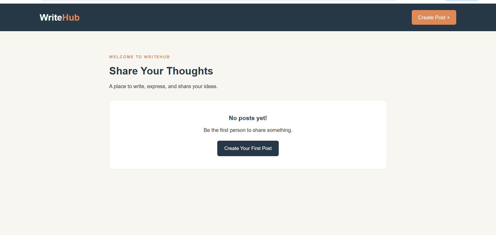

# WriteHub – Blog Web Application

## Project Description

WriteHub is a simple blog web application developed using Node.js, Express.js, and EJS. It allows users to create, view, edit, and delete blog posts.

The application uses temporary storage, so posts are not permanently saved after the server restarts.

## Technologies Used

- Node.js
- Express.js
- EJS
- HTML
- CSS
- JavaScript

## Project Features

- Create new blog posts.
- View all published posts.
- Edit existing posts.
- Delete posts.
- Responsive design for different screen sizes.

## Project Structure

```text
WriteHub-Website/
│
├── app.js
├── package.json
├── package-lock.json
│
├── public/
│   └── styles.css
│
├── views/
│   ├── index.ejs
│   ├── create.ejs
│   └── edit.ejs
│
├── screenshots/
│   └── writehub-home.png
│
└── README.md
```

## How to Run the Application

### Step 1: Clone the Repository

```bash
git clone https://github.com/sangita877/WriteHub-website
```

## Step 2: Open the Project Folder

```bash
cd WriteHub-website
```

### Step 3: Install Dependencies

```bash
npm install
```

### Step 4: Start the Application

```bash
npm start
```

### Step 5: Open the Website

open your browser and visit:

```text
http://localhost:3000
```

## Screenshot


